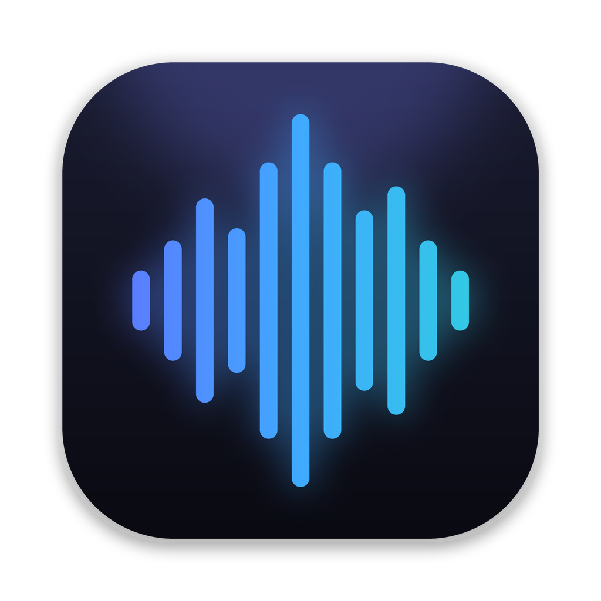
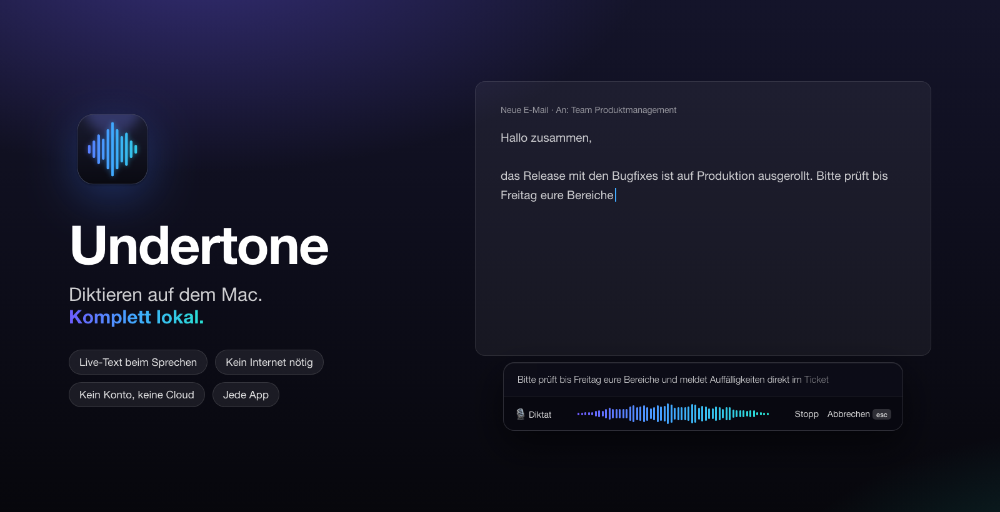
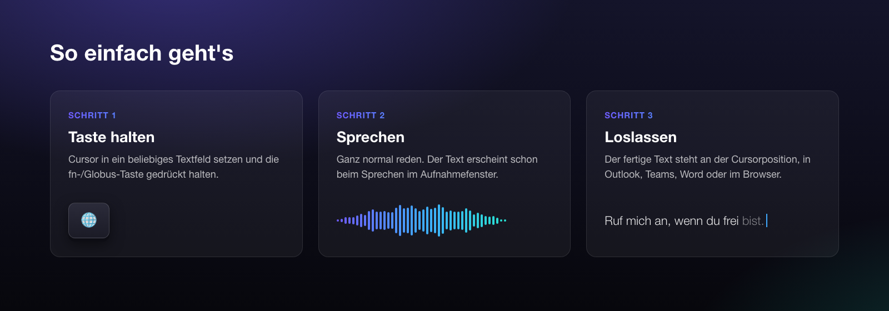
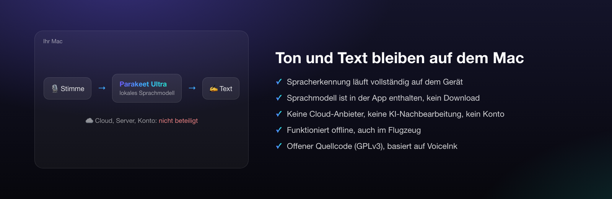

<div align="center">
  
  <h1>Undertone</h1>
  <p><strong>Diktieren auf dem Mac. Komplett lokal.</strong></p>
  <p>Taste halten, sprechen, loslassen: Der Text steht in jeder App an der Cursorposition.<br>
  Ohne Cloud, ohne Konto, ohne Lizenzkosten.</p>
</div>



## Was ist Undertone?

Undertone ist eine Diktat-App für macOS, die gesprochene Sprache direkt auf dem Mac in Text umwandelt.
Sie funktioniert in Outlook, Teams, Word, im Browser und in jedem anderen Programm mit Textfeld.
Schon während Sie sprechen, erscheint der Text im Aufnahmefenster; nach dem Loslassen wird er
eingefügt.

Die Spracherkennung übernimmt **Parakeet Ultra**, ein lokales Sprachmodell für Deutsch, Englisch und viele
weitere europäische Sprachen. Es ist in der App enthalten. Undertone braucht deshalb weder Internet noch einen
Cloud-Dienst, und weder Ton noch Text verlassen den Mac.



## Sprachbefehle und Smileys

Während des Diktierens lassen sich Formatierung und Smileys einfach mitsprechen.
Undertone ersetzt die Befehle beim Einfügen (im Live-Text stehen noch die gesprochenen Wörter).

| Sagen Sie | Ergebnis |
|---|---|
| „neue Zeile“ | Zeilenumbruch |
| „neuer Absatz“ | Leerzeile, neuer Absatz |
| „Doppelpunkt“ · „Semikolon“ | `:` · `;` |
| „Ausrufezeichen“ · „Fragezeichen“ | `!` · `?` |
| „Anführungszeichen auf“ · „Anführungszeichen zu“ | „ · “ (nur „Anführungszeichen“ wechselt selbst zwischen auf und zu) |
| „Klammer auf“ · „Klammer zu“ | `(` · `)` |
| „Bindestrich“ · „Schrägstrich“ | `-` · `/` ohne Leerzeichen, z. B. „E Bindestrich Mail“ → E-Mail |

Punkt und Komma setzt Undertone selbst; dafür gibt es keinen Befehl.

**Smileys:** „Smiley“ (oder „Emoji“) und der Name, zum Beispiel:
„Smiley LOL“ 😂 · „Smiley ROFL“ 🤣 · „Smiley Lachen“ 😄 · „Smiley Zwinkern“ 😉 · „Smiley Daumen hoch“ 👍 ·
„Smiley Herz“ ❤️ · „Smiley Haken“ ✅ · „Smiley Kreuz“ ❌ · „Smiley Party“ 🥳 · „Smiley Danke“ 🙏 ·
„Smiley Idee“ 💡 · „Smiley Kaffee“ ☕ · „Smiley Facepalm“ 🤦 · „Smiley Schulterzucken“ 🤷.
Insgesamt kennt Undertone über 4.000 Smileys; die vollständigen Namen stehen in [`org/smileys.json`](org/smileys.json)
(Abschnitt `kurz` für die Kurznamen, `alle` für die vollständige Liste).

Beides lässt sich in den Einstellungen unter **Sprachbefehle** einzeln abschalten.

## Datenschutz



- Keine Cloud-Transkription, keine KI-Nachbearbeitung, keine Ankündigungen, kein Auto-Update.
- Keine Netzverbindungen im Normalbetrieb. Das Sprachmodell wird beim ersten Start aus der App an
  seinen Platz kopiert.
- Verlauf und Statistik liegen nur lokal unter `~/Library/Application Support/com.undertone.app`.

## Installation

1. `Undertone.zip` unter [Releases](https://github.com/AlverichSven/undertone-releases/releases/latest) laden (enthält App und Sprachmodell
   und `LIESMICH.txt`). Entpackt der Mac die Datei automatisch, einfach den entstandenen Ordner nehmen.
2. `Undertone.app` in den eigenen Ordner **Programme** ziehen (Benutzerordner → Programme).
3. Beim ersten Start: Systemeinstellungen → Datenschutz & Sicherheit → **Dennoch öffnen**
   (die App ist nicht von Apple notarisiert).
4. **Mikrofon** und **Bedienungshilfen** freigeben.
5. Systemeinstellungen → Tastatur → „Taste 🌐 drücken für“ → **Keine Aktion**.

Undertone startet danach automatisch bei der Anmeldung und sitzt in der Menüleiste.
Die Diktiertaste (Standard: fn/Globus, gedrückt halten) lässt sich in den Einstellungen ändern.

**Voraussetzungen:** Mac mit Apple-Chip (M1 oder neuer), macOS 15 oder neuer, ca. 1,5 GB frei.

## Updates

Ab Version 1.0.0 prüft Undertone einmal täglich beim internen Server, ob es eine neue Version gibt, und zeigt
„Neue Version verfügbar“ mit den Neuerungen. Installiert wird nur nach Ihrem Klick; von Hand über das
Menüleisten-Symbol → „Nach Updates suchen …“. Weil Undertone mit einem festen Zertifikat signiert ist, bleiben
die Freigaben für Mikrofon und Bedienungshilfen erhalten. Die Version 1.0.0 selbst einmalig von Hand
installieren und die Freigaben ein letztes Mal erteilen.

## Für Administratoren

| Einstellung | Wie | Wirkung |
|---|---|---|
| Sprachmodell | beim Bau `make org-release MODEL=…` oder `defaults write com.undertone.app transcriptionModel <id>` | erlaubt: `parakeet-ultra` (Standard im Release), `parakeet-tdt-0.6b-v3`, `cohere-transcribe` |
| Modell nicht einbauen | `ORG_BUNDLE_MODEL=0` | kleine App (79 MB), Modell kommt per Datei oder Server |
| Modell-Server | `defaults write com.undertone.app modelServerBaseURL <url>` bzw. `modelArchiveBaseURL` | optionaler Download statt eingebautem Modell |
| Autostart | Standard an | Nutzer kann ihn in den Einstellungen abschalten |
| Update-Quelle | beim Bau `UPDATE_FEED_BASE=…` oder `defaults write com.undertone.app updateFeedBaseURL <url>` | `appcast.xml` und Update-Archive (Nexus Raw) |

Alle Schalter, MDM-Schlüssel und Abläufe stehen in [docs/undertone/ORG-EDITION.md](docs/undertone/ORG-EDITION.md).

## Selbst bauen

Voraussetzungen: Xcode, `brew install cmake`, einmalig `xcodebuild -downloadComponent MetalToolchain`.

```bash
make org-release MODEL=parakeet-ultra
```

Ergebnis: `../dist/Undertone.app` (mit eingebautem Modell) und `../dist/release/Undertone.zip`.
Das Modell wird beim Bau aus `~/Library/Application Support/FluidAudio/Models` übernommen.

Alle Anpassungen gegenüber VoiceInk stehen hinter dem Compile-Flag `ORG_EDITION`
(zentrale Datei `VoiceInk/App/Configuration/OrgEdition.swift`). Ohne das Flag baut das Repository
weiterhin das unveränderte VoiceInk (`make local`), Upstream-Updates lassen sich so mergen.

| Ordner/Datei | Inhalt |
|---|---|
| `VoiceInk/…/Org*.swift` | Undertone-eigene Ansichten und Logik (Einrichtung, Aufnahmefenster, Übersicht, Einstellungen, Modelle) |
| `org/` | Symbol, LIESMICH-Vorlage, deutsche Textanpassungen, Prüfsummen der Modellpakete |
| `scripts/org_*` | Bundle-Patch, Modell einbauen und packen, Symbol erzeugen, Signieren, Veröffentlichen (GitHub Releases, gemeinsamer Ordner) |
| `docs/undertone/` | Grafiken dieser README (Quellen als HTML in `src/`) |

## Herkunft und Lizenz

Undertone ist ein Umbau von [VoiceInk](https://github.com/Beingpax/VoiceInk) von Prakash Joshi Pax und
steht wie das Original unter der **GNU General Public License v3** (siehe `LICENSE`).
Sprachmodell: Parakeet (NVIDIA), CoreML-Fassung von FluidInference, nachtrainierte Ultra-Fassung von Moondream.

Feedback und Fehler bitte über [GitHub Issues](https://github.com/AlverichSven/undertone/issues).
